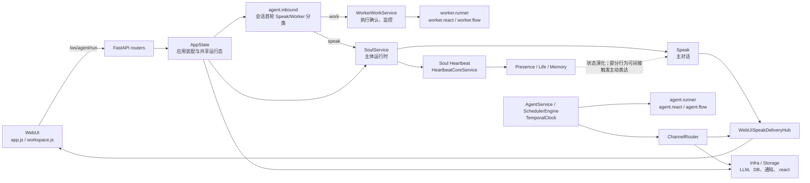
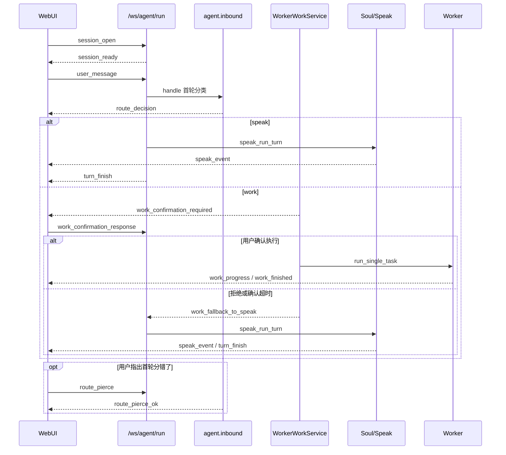

# 栖灵 Animus

栖灵是一个 Soul-first 的驻留型智能体系统：Soul/Speak 负责长期对话与主体状态，Worker 负责需要实际执行的任务，Scheduler、Heartbeat 和多种出站渠道作为独立运行单元接入。WebUI 的主对话入口是 **`/ws/agent/run`**：agent 顶层先做会话首轮 Speak/Worker 分类，再进入 Speak 或 Worker。`/ws/speak/run` 仍是纯 Speak 长连接；`/ws/react/run` 等 legacy ReAct 路径仅为兼容、工具和基准场景保留。

## 当前架构



这不是固定的“三层结构”，而是由 `src/webui/state.py` 的 `AppState` 和 `src/webui/app.py` 的生命周期钩子装配的一组协作运行时：

- **AppState / 应用装配**：持有 `LLMService`、`SoulService`、`InboundRouter`、`WorkerWorkService`、`AgentService`、`SchedulerEngine`、`ChannelRouter`、存储路径、后台任务与连接状态；FastAPI startup 完成实际连线。
- **agent.inbound**：WebUI 会话首轮分类。只判定第一条 `user_message`，钉住 `speak` 或 `work`；不在 Soul/Speak 内。
- **Soul / Speak**：对话运行时。`SoulService` 聚合 Memory、Persona、Life、Presence、Speak 与自身 Heartbeat；Speak 默认使用 `request_driven` pipeline。`/ws/speak/run` 仍可直达 Speak，但浏览器主路径不走它。
- **Worker 执行面**：分类为 work 后，`WorkerWorkService` 只做执行确认、运行和监控；不再用正则 matcher 做主判定。确认后由 `worker.runner` 进入 `worker.react`。`src/agent/react` 与 `src/agent/flow` 仍存在，但不是 WebUI 主对话路径。
- **Scheduler 与 Heartbeat**：`SchedulerEngine` 的 `TemporalClock` 在独立线程执行定时任务；Soul Heartbeat 由 `SoulService` 自己持有和驱动，处理 Presence、Life、Memory 等域的后台演化，部分结果可沿 Soul 内部链路间接形成主动表达。Scheduler 构造时显式传入 `heartbeat=None`，两者不共用时钟，也不存在 Heartbeat 直接调用 Speak 的架构边。
- **Infra / Storage**：`src/infra` 提供 LLM、数据库、网络通知、沙盒与服务注册；`StorageConfig` 将运行数据组织到 `.react/` 下，Soul 也可按 DB 配置选择 JSON 或 MySQL 后端。
- **ChannelRouter**：按 `ReplyTarget.channel` 将 Scheduler 等出站结果路由到 `webui`、`bot`、`bark` 或 `ntfy`。WebUI 渠道进入主动会话投递桥，而不是直接写浏览器连接。

## 主对话与执行流



`/ws/agent/run` 是可复用的双向长连接：首轮分类后同一连接可发送多轮 `user_message`、输入状态 `typing_pulse`、Worker 确认/中止/监控帧、主动消息确认和首轮 `route_pierce`。后续回合不再分类。回复期间继续输入时，Speak 根据会话状态排队或中断当前推进。

Legacy `/ws/react/run`、`/api/react/*` 和 `/ws/chat` 仍被注册，但前端正常会话不经过这些路径；不要据此建立新的 WebUI 对话集成。

## 启动

```bash
pip install -r requirements.txt
python src/run.py
```

统一入口从 `config/agent/run.yaml` 读取 WebUI 默认 host/port（默认端口 8300），检查 LLM 与搜索后在进程内启动 FastAPI。LLM 配置默认位于 `config/llm_core/config.yaml`；Soul 启动还要求 persona 已启用。

启动顺序为：创建 `AppState` 基础设施 → FastAPI startup 建立 `ChannelRouter` → 后台加载 LLM → Soul-first bootstrap → Worker AgentState → Scheduler host。关闭时先解阻 SSE/WS，再停止 Agent/Soul、Scheduler、会话、后台任务、服务注册项和残留线程。

## 源码入口

```text
src/
├── webui/                 # FastAPI、AppState、WebUI 与 Speak/主动消息桥
├── agent/
│   ├── inbound/           # 会话首轮 Speak/Worker 分类
│   ├── soul/              # Soul、Speak、Memory、Persona、Life、Presence、Heartbeat
│   ├── react/             # legacy/可复用 ReAct 实现
│   ├── flow/              # agent 侧流程实现
│   ├── adapters/          # Soul bootstrap 与接入桥
│   └── service.py         # Scheduler host 装配
├── worker/
│   ├── work/              # Worker 执行确认、状态机
│   ├── react/             # Worker ReAct 执行
│   └── flow/              # Worker 流程执行
├── runtime/scheduler/     # SchedulerEngine、TemporalClock、任务存储
├── infra/                 # LLM、DB、网络、通知、沙盒、ChannelRouter
├── config/                # 配置模型与路径
└── run.py                 # WebUI / CLI / check 统一入口
```

## 开发者文档

- [产品形态与商业模式](./product/README.md)
- [WebUI 与 API](./webui/README.md)；[前端 js2 分层架构](./webui/js2-architecture.md)
- [Soul 总览](./agent/soul/README.md)；[Speak](./agent/soul/speak/README.md)；[Heartbeat](./agent/soul/heartbeat/README.md)；[入站路由](./agent/inbound/README.md)
- [ReAct](./agent/react/README.md)；[工具与 Flow](./agent/react/action/README.md)
- [Scheduler](./runtime/README.md)；[常驻服务](./agent/service/README.md)
- [LLM](./infra/llm/README.md)；[数据库](./infra/db/README.md)；[存储](./storage/README.md)；[配置](./config/README.md)
- [Docker 部署](../docker/README.md)
