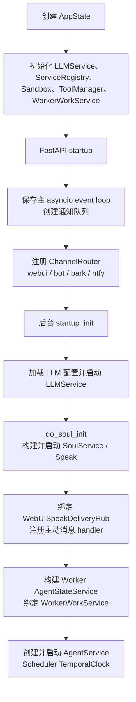
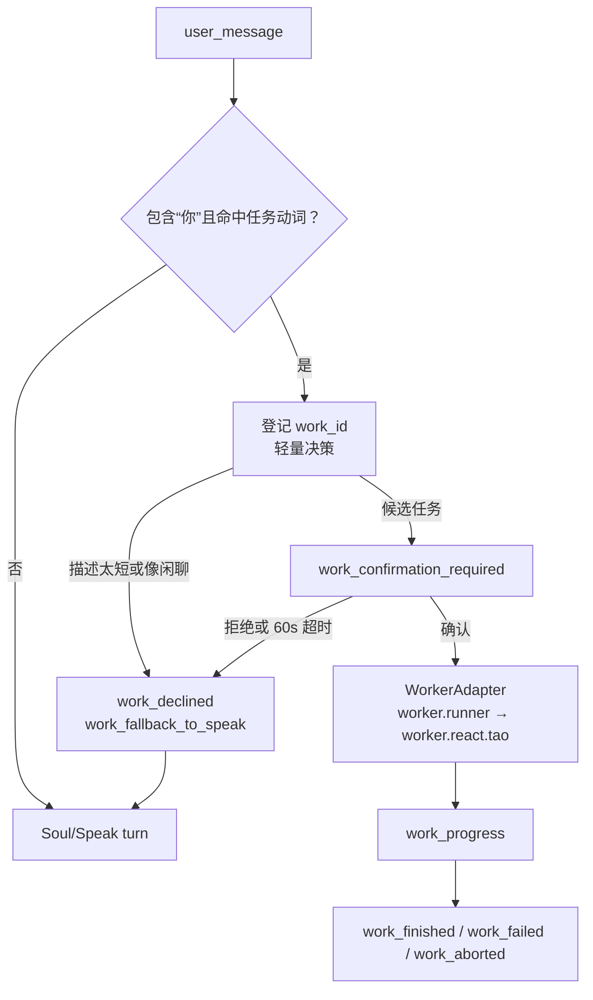

# WebUI

WebUI 是 FastAPI + Vanilla JS 的主产品入口。当前浏览器对话统一使用 Soul/Speak 长连接 **`/ws/speak/run`**；`/ws/react/run`、`/api/react/*` 与 `/ws/chat` 仍被注册，但属于 legacy 路径，不是 `app.js` / `workspace.js` 的正常会话链路。

## 关键文件

| 路径 | 职责 |
|---|---|
| `src/webui/app.py` | FastAPI 应用、router 注册、startup/shutdown 装配 |
| `src/webui/state.py` | 进程内单例 `AppState`，保存服务、连接、队列和存储路径 |
| `src/webui/routers/speak.py` | Speak 状态、通知 SSE、会话调试和主 WebSocket |
| `src/webui/speak_delivery_hub.py` | 将 Soul 主动输出准确投递到 `(session_id, channel_id)` 长连接 |
| `src/webui/static/js/app.js` | 前端 bootstrap、模块注入、DOM 绑定、就绪检查、通知接入 |
| `src/webui/static/js/screens/workspace.js` | Speak 会话、历史切换、Worker UI、主动会话与并发输入 |
| `src/webui/static/js/streaming.js` | `SpeakSession` 长连接协议、重连、turn Promise 与输入脉冲 |
| `src/webui/static/js/modules/notify.js` | `/api/speak/notify` SSE 订阅和重连 |
| `src/webui/static/js/api.js` | 前端真实 API/WS 路径注册表 |
| `src/worker/work/` | Worker 意图匹配、确认状态机、执行适配和事件协议 |

## 启动与关闭

推荐从仓库根目录启动：

```bash
python src/run.py
```

`src/run.py` 从 `config/agent/run.yaml` 读取 WebUI host/port（默认端口 8300），检查 SearXNG、搜索后端和 `config/llm_core/config.yaml`，再将当前进程的 `AppState` 交给 uvicorn。`python src/webui/run.py` 是独立开发入口，代码中固定为 `0.0.0.0:8080` 且开启 reload。

### Startup



若 LLM 配置不存在、模型为空、persona 未启用或 Soul 初始化失败，后台启动会记录 `soul_init_error`，`GET /api/speak/status` 返回 unavailable；前端以 Speak/Soul readiness 为主要就绪信号，不以 legacy ReAct 是否初始化为准。

### Shutdown

信号处理先调用 `AppState.prepare_graceful_shutdown()`：向 SSE/plan 队列写入结束标记，并以 1001 关闭已登记 WebSocket，避免 uvicorn 被长连接阻塞。随后 shutdown hook 依次停止 `AgentService`（同时停止 Soul 与 Scheduler）、备用 Soul/Scheduler、所有会话、后台任务、服务注册项、legacy TaoLoop 和线程注册表。

## Speak WebSocket

### 建连与多轮

`GET /api/speak/status` 用于 readiness；实际会话连接为：

```text
WS /ws/speak/run
```

客户端首先发送 `session_open`：

```json
{
  "type": "session_open",
  "session_id": "conversation-uuid",
  "channel_id": "browser-channel-id",
  "gen_id": "generation-uuid",
  "delivery_mode": "stream",
  "pipeline": "request_driven"
}
```

服务端校验 Soul 后返回 `session_ready`，并将连接登记到 `WebUISpeakDeliveryHub`。同一 WebSocket 可持续发送多轮：

- `user_message`：提交用户文本；默认 pipeline 为 `request_driven`。
- `typing_pulse`：上传正在输入及 draft，服务端返回 `typing_ack`。
- `set_typing_idle_ms`：设置 3000/5000ms 输入空闲阈值。
- `abort`、`ping`、`close`：中止、保活和结束连接。
- `proactive_ack`：确认主动消息 delivery，允许 hub 推送下一条。
- `work_confirmation_response`、`work_abort`、`work_monitor_request`：控制 Worker。

普通 Speak turn 的下行主事件为：

| 事件 | 作用 |
|---|---|
| `turn_start` | 一轮开始，包含 `gen_id`、question、pipeline |
| `speak_event` | Soul `SpeakStreamEvent`，包含 kind、text、final、meta |
| `user_ack` | 当前 Speak 正在推送时，新输入被排队或触发 interrupt |
| `turn_finish` | 一轮结果、answer、pipeline、silence policy 与元数据 |
| `error` / `aborted` / `session_end` | 错误、中止或连接结束 |

`delivery_mode` 支持 `stream` 和 `simulated`。后者由 `SimulatedTypingStreamPort` 包装真实 stream port；二者不改变 Speak 业务结果。

## Worker 意图确认与回落

每个 `user_message` 在进入 Speak 前先经过 `WorkerWorkService.maybe_signal()`：



当前 matcher 是确定性预过滤：文本必须同时含“你”和 `帮/写/改/查/实现/运行/测试/修复` 等任务动词。命中只表示“可能要执行”，不会直接运行；服务端发送 `work_confirmation_required` 并等待确认。用户拒绝、确认超时、描述不足或 chat-like 判断会产生 `work_fallback_to_speak`，router 将原问题重新放入内部 inbound 队列，继续正常 Speak turn。

确认后 Worker 在 daemon thread 中执行 `WorkerAdapter.run_single_task()`，live path 为 `worker.runner` → `worker.react.tao`。进度、结果、失败、监控和中止都作为同一 Speak WS 上的 `work_*` 事件返回，前端将摘要持久化到会话历史。

## 主动消息：SSE 唤醒，WS 交付

`GET /api/speak/notify?channel_id=...` 是通知 SSE，不承载主动消息正文的最终流式展示：

1. Soul 或 Scheduler 产生主动内容，进入 `queue_agent_proactive_session()`。
2. `WebUISpeakDeliveryHub` 若找到精确 `(session_id, channel_id)` 连接，直接排队/投递；否则保存 pending。
3. 离线时只通过 SSE 发布 `proactive_available` 元数据。
4. `modules/notify.js` 收到事件后，`app.js` 用 `_proactiveOpenChain` 串行调用 `workspace.openProactiveSession()`，避免多个主动会话切换相互覆盖。
5. workspace 建立目标 Speak WS；hub 推送 `turn_start`、`speak_event`、`turn_finish`。
6. 前端持久化后发送 `proactive_ack`，hub 移除 pending 并继续下一条。

Hub 会在客户端 turn、server turn 或未确认 delivery 存在时暂缓下一条主动消息，因此主动推送不会与正在进行的用户回复直接交错。

## ChannelRouter

`src/infra/channel_router.py` 是线程安全的 channel → delivery function 注册表。startup 注册：

- `webui`：构造/复用目标 session，经 `queue_agent_proactive_session()` 进入 Speak delivery hub。
- `bot`：交给 `BotService.send_scheduled_reply()`。
- `bark`、`ntfy`：调用对应 notifier。

Scheduler task 的 `reply_target` 由 `ReplyTarget.from_task_dict()` 解析。未指定时按 Bark → ntfy → WebUI 选择可用渠道；WebUI 任务应携带当前 `channel_id` 和 `session_id`，前端创建任务时已填入这两个字段。

## 前端职责与并发桥接

### `app.js`

`app.js` 只负责 bootstrap 和 wiring：注入 feature module，绑定 DOM/event bus，读取 LLM/Soul/Speak 状态，等待 Speak ready，完成 account/channel 选择后进入 workspace，并启动通知 SSE。当前界面只有新对话入口，该按钮进入 Speak workspace。

### `workspace.js`

`workspace.js` 管理前端 conversation、后端 `sessionId` 和跨会话 `channelId`：

- 每个会话持有一条可重连 `SpeakSession`，切换历史时关闭旧连接并连接新 session。
- 回复进行中仍可发送 `user_message`；服务端用 Speak pushing 状态决定 queue/interrupt。
- Worker 确认卡、进度和结果与 Speak 事件共用同一连接。
- 主动会话按 payload 切换 conversation/session，去重 `proactive_intent_id`，保存 unread 状态并发送 delivery ack。
- `app.js` 负责全局模块编排，业务会话逻辑留在 `workspace.js`，协议状态留在 `streaming.js`。

### Python thread ↔ asyncio ↔ browser

Soul Speak 和 Worker 是同步/线程执行面，FastAPI WebSocket 是 asyncio 执行面。桥接方式为：


`WebUISpeakStreamPort.emit()`、Worker session sink 和 delivery hub 都只把 payload 安全投递到 event loop；`_pump_events()` 串行持有 `send_lock` 写 WebSocket。每轮 Speak 在独立线程 lease 中运行，完成后等待 `event_q.join()`，保证所有 stream event 已下发再发送 `turn_finish`。前端 `SpeakSession` 用连接 Promise 防止重复建连，用 turn resolver 队列将每次 `sendTurn()` 与对应 finish/work-pending 结果配对。

## 开发常用 API

| 路径 | 方法 | 用途 |
|---|---|---|
| `/api/speak/status` | GET | Speak readiness |
| `/ws/speak/run` | WS | 主对话、Worker 控制、主动消息交付 |
| `/api/speak/notify` | GET (SSE) | 后台通知与主动会话可用信号 |
| `/api/speak/reset` | POST | finalize 指定 Speak session |
| `/api/speak/session/{session_id}/trace` | GET | 查询会话 prompt trace |
| `/api/speak/session/trace` | POST | 开关会话 prompt trace |
| `/api/speak/session/{session_id}/debug` | GET | 读取 trace 与 session cache |
| `/api/soul/readiness` | GET | Soul 聚合就绪状态 |
| `/api/history`、`/api/history/{id}` | GET/POST/DELETE | 前端会话历史 |
| `/api/scheduler/tasks` | GET/POST | 定时任务 |
| `/api/scheduler/tasks/{id}` | GET/PATCH/DELETE | 单任务管理 |
| `/api/scheduler/status`、`/api/scheduler/control` | GET/POST | 调度时钟状态与控制 |

其他 LLM、Soul、Memory、Persona、Plan、Benchmark、Voice 和 Infra 路径以 `src/webui/routers/` 的 decorator 及 `src/webui/static/js/api.js` 为准。新增浏览器调用时应先登记到 `PATHS`，不要在 feature module 中硬编码 URL。
