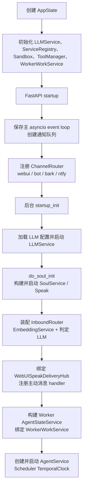
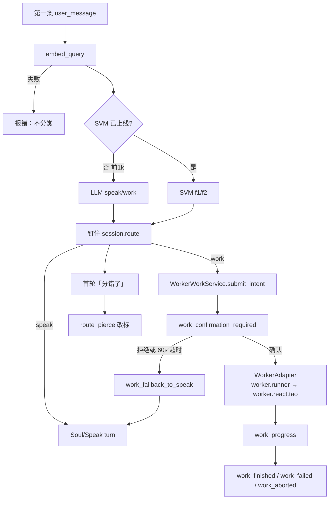

# WebUI

WebUI 是 FastAPI + Vanilla JS 的主产品入口。当前浏览器对话统一使用 agent 顶层长连接 **`/ws/agent/run`**：首轮由 `agent.inbound` 分成 Speak 或 Worker。`/ws/speak/run` 仍是纯 Speak 通道；`/ws/react/run`、`/api/react/*` 与 `/ws/chat` 属于 legacy 路径，不是 `app.js` / `workspace.js` 的正常会话链路。

## 关键文件

| 路径 | 职责 |
|---|---|
| `src/webui/app.py` | FastAPI 应用、router 注册、startup/shutdown 装配 |
| `src/webui/state.py` | 进程内单例 `AppState`，保存服务、连接、队列和存储路径 |
| `src/webui/routers/agent.py` | 浏览器主 WebSocket：首轮分类、Speak 回合、Worker 控制 |
| `src/webui/routers/speak.py` | Speak 状态、通知 SSE、会话调试和纯 Speak WebSocket |
| `src/agent/inbound/` | 会话首轮 Speak/Worker 分类器 |
| `src/webui/speak_delivery_hub.py` | 将 Soul 主动输出准确投递到 `(session_id, channel_id)` 长连接 |
| `src/webui/static/js/app.js` | 前端 bootstrap、模块注入、DOM 绑定、就绪检查、通知接入 |
| `src/webui/static/js/screens/workspace.js` | Speak 会话、历史切换、Worker UI、主动会话与并发输入 |
| `src/webui/static/js/streaming.js` | `SpeakSession` 长连接协议、重连、turn Promise 与输入脉冲 |
| `src/webui/static/js/modules/notify.js` | `/api/speak/notify` SSE 订阅和重连 |
| `src/webui/static/js/api.js` | 前端真实 API/WS 路径注册表 |
| `src/worker/work/` | Worker 执行确认、状态机、适配和事件协议 |

## 启动与关闭

推荐从仓库根目录启动：

```bash
python src/run.py
```

`src/run.py` 从 `config/agent/run.yaml` 读取 WebUI host/port（默认端口 8300），检查 SearXNG、搜索后端和 `config/llm_core/config.yaml`，再将当前进程的 `AppState` 交给 uvicorn。`python src/webui/run.py` 是独立开发入口，代码中固定为 `0.0.0.0:8080` 且开启 reload。

### Startup



若 LLM 配置不存在、模型为空、persona 未启用或 Soul 初始化失败，后台启动会记录 `soul_init_error`，`GET /api/speak/status` 返回 unavailable；前端以 Speak/Soul readiness 为主要就绪信号，不以 legacy ReAct 是否初始化为准。

### Shutdown

信号处理先调用 `AppState.prepare_graceful_shutdown()`：向 SSE/plan 队列写入结束标记，并以 1001 关闭已登记 WebSocket，避免 uvicorn 被长连接阻塞。随后 shutdown hook 依次停止 `AgentService`（同时停止 Soul 与 Scheduler）、备用 Soul/Scheduler、所有会话、后台任务、服务注册项、legacy TaoLoop 和线程注册表。

## Agent WebSocket

### 建连与多轮

`GET /api/speak/status` 用于 Speak readiness；浏览器主会话连接为：

```text
WS /ws/agent/run
```

`/ws/speak/run` 协议相同，但不做首轮分类，也不处理 Worker / `route_pierce`。

客户端首先发送 `session_open`：

```json
{
  "type": "session_open",
  "session_id": "conversation-uuid",
  "channel_id": "browser-channel-id",
  "gen_id": "generation-uuid",
  "delivery_mode": "stream",
  "pipeline": "request_driven"
}
```

服务端校验 Soul 后返回 `session_ready`，并将连接登记到 `WebUISpeakDeliveryHub`。同一 WebSocket 可持续发送多轮：

- `user_message`：提交用户文本；默认 pipeline 为 `request_driven`。
- `typing_pulse`：上传正在输入及 draft，服务端返回 `typing_ack`。
- `set_typing_idle_ms`：设置 3000/5000ms 输入空闲阈值。
- `abort`、`ping`、`close`：中止、保活和结束连接。
- `proactive_ack`：确认主动消息 delivery，允许 hub 推送下一条。
- `work_confirmation_response`、`work_abort`、`work_monitor_request`：控制 Worker 执行（不是分类）。
- `route_pierce`：只针对本会话首轮结果，用户指出分类错误。

普通 Speak turn 的下行主事件为：

| 事件 | 作用 |
|---|---|
| `session_ready` | 握手成功，回带 `gen_id/session_id/delivery_mode/pipeline`，agent 通道额外含 `agent_route: true` |
| `turn_start` | 一轮开始，包含 `gen_id`、question、pipeline；agent 通道另有 `route: "speak"` 与 `route_source`（`sticky`/`route_pierce`/`work_fallback`） |
| `speak_event` | Soul `SpeakStreamEvent`，包含 kind、text、final、meta；kind ∈ `chunk\|tag\|thought\|speak\|action\|state\|anchor\|observe\|segment\|agent_typing\|finish\|error`，meta 约定见 `static/js2/protocol/speak_fields.js` |
| `turn_finish` | 一轮结果与元数据，schema 见下文 |
| `route_decision` | 会话首轮分类结果：`speak` 或 `work` |
| `route_pierce_ok` | 用户纠错后的新标签 |
| `error` / `aborted` / `session_end` | 错误、中止或连接结束 |

> 注：早期文档列出的下行 `user_ack` 帧已不存在——排队/打断决策发生在服务端，
> 表现为该轮 `turn_finish.meta.queued` / `interrupt` 标志，前端不再接收独立 ack 帧。

### `turn_finish` payload schema

由 `_serialize_turn_result()`（`routers/agent.py` / `routers/speak.py`）序列化：

```json
{
  "gen_id": "...", "session_id": "...", "answer": "...",
  "session_state": "finish", "pipeline": "request_driven",
  "queued": false, "interrupt": false, "recorded": true,
  "notes": [], "output": {}, "meta": {"created_at": "..."},
  "silence_policy": null, "hide_agent": false,
  "speak_events": [{"kind": "speak", "text": "...", "final": false, "meta": {}}],
  "created_at": "2026-01-01T00:00:00+00:00"
}
```

hub 主动投递的 server-initiated 变体只保留其子集并附加
`server_initiated: true, delivery_id, answer, speak_events`。

### `work_*` 事件帧

经 `WorkerWorkService` session sink 在同一 agent WS 上推送，公共字段：
`type, work_id, status, message, payload(dict), created_at, seq(int)`，可选
`reason/reason_code/gen_id/session_id`。类型清单：

| type | status | payload 要点 |
|---|---|---|
| `work_intent_detected` | detected | question、matched_terms[]、confidence |
| `work_confirmation_required` | pending_confirmation | prompt、suggested_action、timeout_sec（60s 自动拒绝） |
| `work_declined` | declined | fallback_to_speak、surface_to_user |
| `work_fallback_to_speak` | — | question（服务端随后自动转入 speak 回合） |
| `work_started` | starting | runner="sub_agent"、question |
| `work_progress` | running | phase/text 等增量信息 |
| `work_monitor` | running | 监控快照（step_count 等） |
| `work_finished` | finished | answer、step_count、steps_log[] |
| `work_failed` | failed | error（reason_code=worker_error） |
| `work_aborted` | aborted | reason_code=user_abort 或 aborted |

`delivery_mode` 支持 `stream` 和 `simulated`。后者由 `SimulatedTypingStreamPort` 包装真实 stream port；二者不改变 Speak 业务结果。

## 首轮分类与 Worker 执行确认

只有会话第一条 `user_message` 经过 `agent.inbound.InboundRouter`。分类依赖 embedding；前 1000 次全局首轮走 embedding 接地 LLM，金池够了再异步上线二维线性 SVM。详见 [agent/inbound](../agent/inbound/README.md)。



击穿是用户说首轮标签错了，不是间隔不够。Worker 确认卡只问「要不要执行」。`reason` 以 `agent_inbound` 开头的信号不再做「你 + 动词」二次分类。

确认后 Worker 在 daemon thread 中执行 `WorkerAdapter.run_single_task()`，live path 为 `worker.runner` → `worker.react.tao`。进度、结果、失败、监控和中止都作为同一 agent WS 上的 `work_*` 事件返回，前端将摘要持久化到会话历史。

## 主动消息：SSE 唤醒，WS 交付

`GET /api/speak/notify?channel_id=...` 是通知 SSE，不承载主动消息正文的最终流式展示：

1. Soul 或 Scheduler 产生主动内容，进入 `queue_agent_proactive_session()`。
2. `WebUISpeakDeliveryHub` 若找到精确 `(session_id, channel_id)` 连接，直接排队/投递；否则保存 pending。
3. 离线时只通过 SSE 发布 `proactive_available` 元数据。
4. `modules/notify.js` 收到事件后，`app.js` 用 `_proactiveOpenChain` 串行调用 `workspace.openProactiveSession()`，避免多个主动会话切换相互覆盖。
5. workspace 建立目标 agent WS；hub 推送 `turn_start`、`speak_event`、`turn_finish`。
6. 前端持久化后发送 `proactive_ack`，hub 移除 pending 并继续下一条。

Hub 会在客户端 turn、server turn 或未确认 delivery 存在时暂缓下一条主动消息，因此主动推送不会与正在进行的用户回复直接交错。

## ChannelRouter

`src/infra/channel_router.py` 是线程安全的 channel → delivery function 注册表。startup 注册：

- `webui`：构造/复用目标 session，经 `queue_agent_proactive_session()` 进入 Speak delivery hub。
- `bot`：交给 `BotService.send_scheduled_reply()`。
- `bark`、`ntfy`：调用对应 notifier。

Scheduler task 的 `reply_target` 由 `ReplyTarget.from_task_dict()` 解析。未指定时按 Bark → ntfy → WebUI 选择可用渠道；WebUI 任务应携带当前 `channel_id` 和 `session_id`，前端创建任务时已填入这两个字段。

## 前端职责与并发桥接

### `app.js`

`app.js` 只负责 bootstrap 和 wiring：注入 feature module，绑定 DOM/event bus，读取 LLM/Soul/Speak 状态，等待 Speak ready，完成 account/channel 选择后进入 workspace，并启动通知 SSE。当前界面只有新对话入口，该按钮进入 Speak workspace。

### `workspace.js`

`workspace.js` 管理前端 conversation、后端 `sessionId` 和跨会话 `channelId`：

- 每个会话持有一条可重连 `SpeakSession`，切换历史时关闭旧连接并连接新 session。
- 回复进行中仍可发送 `user_message`；服务端用 Speak pushing 状态决定 queue/interrupt。
- Worker 确认卡、进度和结果与 Speak 事件共用同一连接。
- 主动会话按 payload 切换 conversation/session，去重 `proactive_intent_id`，保存 unread 状态并发送 delivery ack。
- `app.js` 负责全局模块编排，业务会话逻辑留在 `workspace.js`，协议状态留在 `streaming.js`。

### Python thread ↔ asyncio ↔ browser

Soul Speak 和 Worker 是同步/线程执行面，FastAPI WebSocket 是 asyncio 执行面。桥接方式为：


`WebUISpeakStreamPort.emit()`、Worker session sink 和 delivery hub 都只把 payload 安全投递到 event loop；`_pump_events()` 串行持有 `send_lock` 写 WebSocket。每轮 Speak 在独立线程 lease 中运行，完成后等待 `event_q.join()`，保证所有 stream event 已下发再发送 `turn_finish`。前端 `SpeakSession` 用连接 Promise 防止重复建连，用 turn resolver 队列将每次 `sendTurn()` 与对应 finish/work-pending 结果配对。

## 开发常用 API

| 路径 | 方法 | 用途 |
|---|---|---|
| `/api/speak/status` | GET | Speak readiness |
| `/ws/agent/run` | WS | 主对话入口：首轮分类、Speak、Worker 控制、主动消息交付 |
| `/ws/speak/run` | WS | 纯 Speak 长连接（不分类） |
| `/api/speak/notify` | GET (SSE) | 后台通知与主动会话可用信号 |
| `/api/speak/reset` | POST | finalize 指定 Speak session |
| `/api/speak/session/{session_id}/trace` | GET | 查询会话 prompt trace |
| `/api/speak/session/trace` | POST | 开关会话 prompt trace |
| `/api/speak/session/{session_id}/debug` | GET | 读取 trace 与 session cache |
| `/api/soul/readiness` | GET | Soul 聚合就绪状态 |
| `/api/history`、`/api/history/{id}` | GET/POST/DELETE | 前端会话历史 |
| `/api/scheduler/tasks` | GET/POST | 定时任务 |
| `/api/scheduler/tasks/{id}` | GET/PATCH/DELETE | 单任务管理 |
| `/api/scheduler/status`、`/api/scheduler/control` | GET/POST | 调度时钟状态与控制 |

其他 LLM、Soul、Memory、Persona、Plan、Benchmark、Voice 和 Infra 路径以 `src/webui/routers/` 的 decorator 及 `src/webui/static/js/api.js` 为准。新增浏览器调用时应先登记到 `PATHS`，不要在 feature module 中硬编码 URL。

## 设置门面协议（模型配置）

设置页涉及模型选择的端点、载体文件与生效时机对照。协议原则：**每一类模型只有一个权威载体文件**，UI 只写权威源，不在多个文件间制造副本。

| 配置项 | 端点 | 权威载体 | 生效时机 |
|---|---|---|---|
| 主语言模型 | `GET /api/config`、`POST /api/config/save`、`PATCH /api/llm`（热切换，流式期间 409） | `config/llm_core/config.yaml` | 保存即写盘；`PATCH` 原地热切换 handle |
| 次语言模型（aux） | `GET /api/llm/aux`、`POST /api/llm/aux/save` | `config/llm_core/aux_models.yaml`（`AuxLLMRegistry`） | 保存即热注册 `register_aux`/`unregister_aux`，逐槽回报结果；webui 启动时在 Soul 初始化前自动加载 |
| Embedding 模型 | `GET|POST /api/embedding/config` | `config/embedding/model.yaml`（`EmbeddingConfig`，全项目唯一来源） | `requires_restart: true`——向量维度变化需重建 Qdrant collection，不做热切换 |
| Soul 向量设施（Qdrant path/collection） | `GET|POST /api/soul/memory/infra(/save)` | `config/soul/memory/infra.yaml` | 需重新初始化 Soul |

次模型槽位与 soul 消费方 `resolve_module_llm` 的 aux 名一一对应：`life / persona / memory / presence / speak / speak_director / heartbeat`；`enabled=false` 或未列出的槽位回退主模型。aux 仅允许 `openai` 兼容 API 后端（`register_aux` 语义是 API-only），本地大模型走主模型热切换协议。soul 设置页的「LLM Aux 名」区块只是模块→槽位名映射，模型本体在「模型 → 次语言模型（Aux）」配置。

注意：soul 设置页不再向 `/api/soul/memory/infra/save` 发送 embedding 段——`SoulMemoryInfraConfig.load_default()` 加载时会用 `config/embedding/model.yaml` 无条件覆盖 embedding 字段（`_apply_embedding_override`），写入 infra.yaml 的 embedding 值不生效。UI 的 embedding 字段已改接 `/api/embedding/config`。
